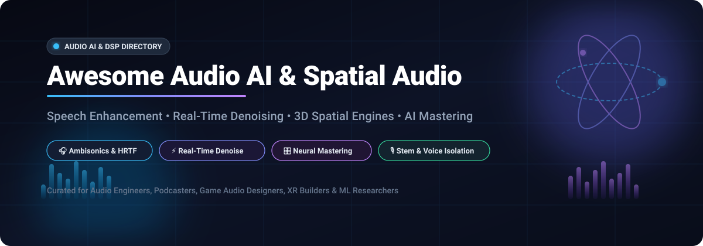

# 🎧 Awesome Audio AI & Spatial Audio Processing

  

  
  
  
  
  
  

---

## 📌 Executive Summary & Repository Overview

A comprehensive, SEO-optimized, community-curated index of the **top Audio AI algorithms, SaaS hosted platforms, and open-source GitHub projects**. This directory tracks cutting-edge tools for **AI speech enhancement**, **real-time background noise cancellation**, **neural audio mastering**, **stem source separation**, **speech super-resolution**, and **3D spatial audio engines** (Ambisonics, HRTF, binaural rendering, acoustic raytracing).

Whether you are building VoIP communication pipelines, mixing XR spatial game audio, mastering broadcast podcasts, or conducting neural audio research, this ecosystem map covers commercial SaaS APIs and open-source foundation models.

---

## 📑 Table of Contents

- [📊 Sector Overview & Market Dynamics](#-sector-overview--market-dynamics)
- [☁️ SaaS & Hosted Audio AI Platforms](#️-saas--hosted-audio-ai-platforms)
- [💻 Open-Source GitHub Projects](#-open-source-github-projects)
  - [⭐ Open-Source Audio AI & Spatial Audio Ranking](#-open-source-audio-ai--spatial-audio-ranking)
  - [📦 Core Audio AI Libraries & Development Frameworks](#-core-audio-ai-libraries--development-frameworks)
- [📈 Star History](#-star-history)
- [💖 Support & Sponsorship](#-support--sponsorship)
- [🤝 How to Contribute](#-how-to-contribute)
- [⚖️ Disclaimer & Licensing](#️-disclaimer--licensing)

---

## 📊 Sector Overview & Market Dynamics

The global **Audio & Voice AI market** is valued at approximately **$12B–$14B** and is projected to expand toward **$117B by 2033** (CAGR ~19%–30%), while the **3D & Spatial Audio market** sits at **$6.8B** on track to exceed **$25B** (CAGR ~13%–14%). The sector displays **moderate fragmentation with emergent platform concentration**: foundation speech recognition and foundational spatial SDKs are consolidating around mega-cap infrastructure leaders (Adobe, Apple, Google, Dolby, Meta), while real-time DSP noise suppression, podcast audio restoration, and automated AI mastering remain dynamic, highly contested vertical niches with agile challenger startups.

---

## ☁️ SaaS & Hosted Audio AI Platforms

Below is the structured breakdown of leading commercial Audio AI and post-production SaaS services, sorted by company scale (market capitalization / valuation / annual revenue in descending order).

| Platform | Company Scale (Valuation / Revenue) | Starting Pricing (Paid Tier) | Free Tier / Trial Limits | Core Focus & Audio AI Capabilities |
| :--- | :--- | :--- | :--- | :--- |
| **[Adobe Podcast (Enhance Speech)](https://podcast.adobe.com)** | **~$85B–$100B Market Cap** ($25.97B Rev) | **$9.99/mo** (Express / Firefly Pro tier) | **1 hour/day free forever** (max 30 min / 500 MB per file, audio-only) | Cloud AI speech enhancement, vocal room echo removal, mic check acoustic analysis. |
| **[Dolby.io](https://dolby.io)** | **~$5.1B–$5.5B Market Cap** ($1.42B Rev) | **$25/mo** (Pay-as-you-go / starter credit tier) | **200 free media processing minutes/month** (API trial credits) | Enterprise spatial audio APIs, Dolby Atmos mastering, broadcast noise leveling. |
| **[Descript (Studio Sound)](https://descript.com)** | **~$550M Valuation** (~$35M–$50M ARR) | **$19/seat/mo** (Hobbyist tier, $12/mo billed annually) | **1 media hour/mo free forever** (100 one-time AI credits, 720p watermarked export, 5 GB storage) | Text-based audio/video editor, one-click Studio Sound vocal isolation, filler word deletion. |
| **[LANDR](https://landr.com)** | **~$100M–$250M Valuation** (~$12M–$15M Rev) | **$19.99/mo** (Studio Standard, $11.99/mo billed annually) | **Free forever previews only** (no free exports; paid WAV/MP3 downloads required) | Automated AI music mastering, stem separation, reference track matching, distribution. |
| **[Krisp](https://krisp.ai)** | **~$150M–$200M Valuation** (~$38M–$41M ARR) | **$12/user/mo** ($8/user/mo billed annually) | **60 minutes/day free forever** (noise cancellation; 7-day unlimited trial for Pro) | On-device bi-directional AI background noise suppression, echo cancellation, AI meeting transcription. |
| **[WavePad (NCH Software)](https://www.nch.com.au/wavepad)** | **~$15M–$30M Estimated Rev** (Bootstrapped) | **$39.95 one-time** (Standard) / **$5.50/mo** (Quarterly plan) | **14-day free trial** of Master's Edition; reverts to free non-commercial basic edition | Desktop digital audio editor, spectral noise subtraction, batch conversion, VST effect chains. |
| **[Cleanvoice AI](https://cleanvoice.ai)** | **~$2M–$5M Estimated ARR** (Early Stage) | **$11/mo** (Starter subscription: 10 hrs/mo) or **$11 one-time** (5 hrs pay-as-you-go) | **30 minutes free one-time trial** (all tools unlocked, no expiration, no credit card required) | AI podcast vocal cleanup, stutter & hesitation removal, mouth sound and breath suppression. |
| **[AudioNodes](https://www.audionodes.com/)** | **~$1M–$3M Estimated ARR** (Independent) | **$9.99/mo** ($99.99/year for AudioNodes HD) | **Free forever tier** (unlimited nodes & timeline tracks, stereo rendering up to 48 kHz; HD unlocks 7.1 surround & 96 kHz) | Modular web & desktop digital audio workstation, node-based patcher, real-time spatial panning. |
| **[Auphonic](https://auphonic.com)** | **~$750K Estimated ARR** (Bootstrapped) | **$13/mo** (~€11/mo for 9 hours monthly) or **$14 one-time** (5 hour credit pack) | **2 hours/month free forever** (includes automated Auphonic jingle in processed output) | Intelligent vocal leveling, noise/reverb filtering, automated EBU R128 & podcast LUFS loudness normalization. |
| **[Soundop](https://soundop.com)** | **~$500K Estimated ARR** (Ivosight) | **$99 one-time perpetual** or **$14.99/mo** subscription | **7-day free trial**; permanent Demo Mode afterwards (inserts 500ms mute every 15s in exported audio) | Professional Windows multitrack audio editor, spectral frequency isolation, VST3 plugin mastering suite. |

---

## 💻 Open-Source GitHub Projects

Explore the most prominent open-source repositories powering modern Audio AI, neural speech enhancement, source separation, and spatial acoustic simulation. All entries are ranked by GitHub stargazer counts in descending order.

### ⭐ Open-Source Audio AI & Spatial Audio Ranking

| Repository | GitHub Stars Badge | Primary License | Core Architectural Focus & Capabilities |
| :--- | :--- | :--- | :--- |
| **[openai/whisper](https://github.com/openai/whisper)** |  | MIT | General-purpose speech recognition, voice activity detection, and multilingual audio transcription. |
| **[headroomlabs-ai/headroom](https://github.com/headroomlabs-ai/headroom)** |  | Apache-2.0 | High-performance context optimization proxy and MCP server for real-time agent/LLM pipelines. |
| **[facebookresearch/fairseq](https://github.com/facebookresearch/fairseq)** |  | MIT | Meta AI sequence-to-sequence toolkit featuring wav2vec 2.0 self-supervised speech representation. |
| **[Anjok07/ultimatevocalremovergui](https://github.com/Anjok07/ultimatevocalremovergui)** |  | MIT | GUI and neural engine for vocal isolation and instrumental extraction using MDX-Net, VR Arch, and Demucs. |
| **[m-bain/whisperX](https://github.com/m-bain/whisperX)** |  | BSD-2-Clause | Accelerated Whisper speech transcription with phoneme-level forced alignment and multi-speaker diarization. |
| **[facebookresearch/audiocraft](https://github.com/facebookresearch/audiocraft)** |  | MIT | Meta AI generative audio framework featuring MusicGen, AudioGen, and EnCodec neural compression. |
| **[audacity/audacity](https://github.com/audacity/audacity)** |  | GPL-3.0 | Multi-track audio editor with Intel OpenVINO deep learning plugins for stem separation and AI suppression. |
| **[speechbrain/speechbrain](https://github.com/speechbrain/speechbrain)** |  | Apache-2.0 | PyTorch all-in-one conversational speech toolkit for neural speech enhancement, separation, and diarization. |
| **[LMMS/lmms](https://github.com/LMMS/lmms)** |  | GPL-2.0 | Cross-platform digital audio workstation featuring MIDI sequencing, sound synthesis, and multi-channel effects. |
| **[facebookresearch/demucs](https://github.com/facebookresearch/demucs)** |  | MIT | State-of-the-art hybrid Transformer/waveform music and vocal source separation (vocals, drums, bass, stems). |
| **[librosa/librosa](https://github.com/librosa/librosa)** |  | ISC | Fundamental Python library for music and audio analysis, mel-spectrogram computation, and feature extraction. |
| **[spotify/pedalboard](https://github.com/spotify/pedalboard)** |  | GPL-3.0 | Spotify high-speed Python audio framework for hosting VST3/AU plugins, studio effects, and batch processing. |
| **[xiph/rnnoise](https://github.com/xiph/rnnoise)** |  | BSD-3-Clause | Ultra-lightweight recurrent neural network real-time noise suppression in C, standard in WebRTC & OBS. |
| **[Ardour/ardour](https://github.com/Ardour/ardour)** |  | GPL-2.0 | Professional DAW supporting unlimited multitrack audio recording, multichannel surround panning, and mastering. |
| **[Rikorose/DeepFilterNet](https://github.com/Rikorose/DeepFilterNet)** |  | MIT / Apache-2.0 | Real-time full-band (48 kHz) deep learning speech enhancement and noise suppression in Rust/Python/PipeWire. |
| **[ValveSoftware/steam-audio](https://github.com/ValveSoftware/steam-audio)** |  | Apache-2.0 | Physics-based spatial audio SDK with HRTF binaural rendering, acoustic occlusion, and geometry raytracing. |
| **[pytorch/audio](https://github.com/pytorch/audio)** |  | BSD-2-Clause | PyTorch official audio tensor I/O, spectrogram transformations, beamforming, and pretrained acoustic models. |
| **[sergree/matchering](https://github.com/sergree/matchering)** |  | GPL-3.0 | Containerized reference-based automated audio mastering, matching frequency response, RMS, and stereo width. |
| **[resemble-ai/resemble-enhance](https://github.com/resemble-ai/resemble-enhance)** |  | Apache-2.0 | AI speech denoising and dual-stage super-resolution restoring high frequencies up to 44.1 kHz. |
| **[haoheliu/versatile_audio_super_resolution](https://github.com/haoheliu/versatile_audio_super_resolution)** |  | Apache-2.0 | AudioSR diffusion model upscaling arbitrary speech, music, and environmental sound effects to 48 kHz. |
| **[tenacityteam/tenacity](https://github.com/tenacityteam/tenacity)** |  | GPL-2.0 | Privacy-respecting, zero-telemetry community fork of Audacity for multitrack recording and editing. |
| **[resonance-audio/resonance-audio](https://github.com/resonance-audio/resonance-audio)** |  | Apache-2.0 | Cross-platform multi-platform 3D spatial audio SDK reproducing acoustic environments for XR and games. |
| **[iem-projects/IEMPluginSuite](https://github.com/iem-projects/IEMPluginSuite)** |  | GPL-3.0 | Open-source Higher-Order Ambisonics (HOA) VST/LV2 suite for spatial sound directivity and binaural rendering. |

---

### 📦 Core Audio AI Libraries & Development Frameworks

For audio engineers and ML practitioners developing customized pipelines:

- **Speech Cleanup & Enhancement**: Combine **[DeepFilterNet](https://github.com/Rikorose/DeepFilterNet)** (low-latency CPU/GPU streaming) or **[Resemble Enhance](https://github.com/resemble-ai/resemble-enhance)** (speech super-resolution).
- **Mastering & Loudness Normalization**: Integrate **[Spotify Pedalboard](https://github.com/spotify/pedalboard)** with FFmpeg `loudnorm` (EBU R128) and **[matchering](https://github.com/sergree/matchering)**.
- **3D Spatial Acoustic Engines**: Integrate **[Steam Audio](https://github.com/ValveSoftware/steam-audio)** for real-time physics acoustics or **[IEM Plugin Suite](https://github.com/iem-projects/IEMPluginSuite)** for professional multichannel Ambisonics.

---

## 📈 Star History

---

## 💖 Support & Sponsorship

Thank you for exploring this curated repository! If you find this resource valuable for your research, production, or engineering workflow:

- ⭐ **Star** this repository to help others discover it
- 🍴 **Fork** and contribute new tools or updates via Pull Requests
- 📢 **Share** with your audio engineering and AI communities
- ☕ **Support the maintainer**: Buy me a coffee and sponsor development via the [GitHub Sponsors Dashboard](https://github.com/sponsors/ishandutta2007)

---

## 🤝 How to Contribute

Contributions are welcome! Please follow these steps:

1. Fork this repository.
2. Ensure new additions align with **Audio AI**, **Speech Enhancement**, or **Spatial Audio Processing**.
3. For SaaS products, include transparent pricing and free tier/trial boundaries.
4. For open-source tools, include the repository URL, license, and primary architectural capability.
5. Submit a pull request with a concise description of your changes.

Check out our curated mega-directory at **[Awesome-Awesome-Awesome](https://github.com/ishandutta2007/Awesome-Awesome-Awesome)** for more open-source collections.

---

## ⚖️ Disclaimer & Licensing

- This list is community-curated for informational, academic, and technical evaluation purposes.
- Neural audio enhancement and generative speech models can occasionally introduce phase artifacts; always audition rendered outputs in professional monitoring environments.
- Verify software licenses (MIT, Apache-2.0, GPL, LGPL) prior to integrating open-source DSP engines or SDKs into commercial applications.

---

  <b>Built with ❤️ for audio engineers, game sound designers, acoustic researchers, and open-source creators worldwide.</b>

